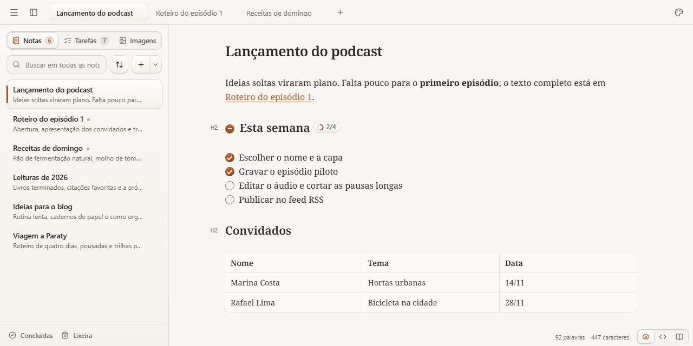

# Sloth Note

Um bloco de notas com Markdown para escrever, organizar ideias e fechar a janela sem pensar em salvar. Local, sem conta e com salvamento automático.



## Escreva do seu jeito

- **Três modos para a mesma nota:** Padrão, com Markdown formatado enquanto você escreve; Código, com o texto original; e Leitura.
- **Notas conectadas:** abas, links `[[Nota]]`, referências a títulos e lista de notas que apontam para o documento atual.
- **Busca onde precisar:** encontre notas pelo nome, pesquise no conteúdo de todas elas com trechos destacados ou busque e substitua dentro de uma nota.
- **Listas e tarefas:** sublistas, reordenação pelo teclado, visão de tarefas na biblioteca e controles para concluir as tarefas de uma seção.
- **Markdown além do básico:** digite `/` numa linha vazia para buscar blocos; copie ou recolha blocos de código e escolha entre quebrar linhas e rolar horizontalmente. A configuração global de quebra fica em Configurações → Editor.
- **Tabelas:** o mesmo menu abre pelas barras acima das colunas e à esquerda das linhas, pelo ícone no canto da tabela e pelo clique com o botão direito numa célula. Ele age nas células selecionadas (ou na tabela inteira): cores, alinhamento horizontal e vertical, formatação, inserir e remover linhas e colunas, copiar, exportar e cabeçalhos. A linha de cabeçalho fica visível ao rolar; aponte para os pontos nas bordas para inserir linhas e colunas. O cabeçalho é guardado num comentário `<!-- sloth:table … -->` acima da tabela.
- **Alça de blocos:** com o mouse, cada bloco mostra uma alça à esquerda para transformar, recortar, copiar, excluir, adicionar abaixo ou arrastar. Um título recolhido leva a seção ao ser arrastado. Ao selecionar texto, a barra mostra o tipo do bloco, negrito, tachado, itálico, link, código e mais ações.
- **Tabelas:** arraste a divisão entre colunas para redistribuir sua largura. A tabela sempre preenche o documento e as linhas têm altura automática. As tabelas funcionam como planilha: um clique seleciona, arrastar ou Shift seleciona várias células, e clique duplo, F2 ou digitar edita. As barras externas identificam colunas por letras e linhas por números. Copie e cole blocos de células de e para Excel ou Google Sheets. Arraste o quadradinho no canto inferior direito da seleção para copiar células nas linhas ou colunas vizinhas; fórmulas copiadas dentro do app ajustam suas referências relativas, preservando as partes fixadas com `$`. Células que começam com `=` são fórmulas (`=SOMA(B2:B5)`, `=SE(A2>0;"sim";"não")`); o arquivo guarda a fórmula. Ao digitar `=`, escolha uma função na lista; a primeira linha da tabela é a linha 1 nas referências. Clique com o botão direito numa célula para escolher cores. Ao editar, Shift+Enter quebra a linha e continua listas e tarefas (`- [ ]`). No menu da tabela, exporte os textos como CSV (UTF-8, ponto e vírgula) ou XLSX; as células XLSX são texto, sem fórmulas nem formatação.
- **Sumário:** no editor padrão, abra o botão à esquerda para navegar pelos títulos e recolher subtítulos. Em linhas vazias, use **+** para inserir um bloco.
- **Duas notas:** use o menu de uma aba ou arraste-a para o editor para consultá-la ao lado. A nota lateral abre em leitura; clique no nome para editá-la.
- **Colunas:** digite `/` e escolha Colunas; use + para acrescentar colunas e arraste uma seleção com o mouse ou use recortar e colar para mover texto. A edição mostra Markdown; na leitura ele aparece formatado. Remover o layout mantém o conteúdo. As notas usam comentários HTML para delimitar as colunas e permanecem legíveis em sequência em outros leitores Markdown.
- **Imagens junto das ideias:** cole ou arraste arquivos, reutilize imagens da biblioteca e encontre as notas que as utilizam.
- **Um espaço para se concentrar:** modo de foco, temas claro e escuro, fonte, tamanho do texto e largura do documento ajustáveis. Interface em português do Brasil ou inglês.

## Primeiros passos

O aplicativo desktop usa **Tauri 2**. O fluxo de release prepara instaladores para **Windows** (`.exe`, NSIS) e **Linux** (`.AppImage`). Consulte as [releases do projeto](https://github.com/dougkusanagi/sloth-noter/releases) para os artefatos publicados. As atualizações usam pacotes assinados pelo projeto. No desktop instalado, o app verifica releases estáveis ao iniciar. **Baixar atualização** baixa e verifica o pacote dentro do app; depois, **Instalar e reiniciar** salva as notas pendentes e aplica a versão. Use **menu principal → Verificar atualizações** para consultar novamente; sem conexão, o editor continua funcionando offline. A primeira compilação com esse recurso precisa ser instalada manualmente. A assinatura do updater não substitui a assinatura de código reconhecida pelo Windows.

1. Abra o app e explore a nota **Welcome**, com exemplos editáveis dos recursos de Markdown.
2. Crie uma nota. A primeira linha com `# Título` também dá nome ao arquivo.
3. Para trabalhar com arquivos `.md` em uma pasta sua, abra **Configurações → Dados** e escolha a pasta de notas.

No desktop, você também pode associar `.md`, `.markdown` e `.txt` ao Sloth Note e abri-los pelo sistema. Arquivos abertos pelo sistema ou soltados na janela são editados no próprio local, mesmo fora da pasta de notas. Para que os arquivos de uma pasta sejam notas do app, escolha-a em **Configurações → Dados**. Solte um arquivo sobre o texto e o app pergunta se você quer editar o original ou importar uma cópia.

A página Welcome pode ser excluída. Para gerar uma cópia atualizada, abra a paleta com `Ctrl+Shift+P` e escolha **Recriar página de ajuda**.

### Atalhos para começar

Use `Ctrl` no Windows/Linux e `Cmd` no macOS. Atalhos como criar e fechar abas podem ser interceptados pelo navegador; no desktop, pertencem ao app.

| Ação                                         | Atalho                         |
| -------------------------------------------- | ------------------------------ |
| Nova nota                                    | `Ctrl+T`                       |
| Menu principal / biblioteca                  | `F10` / `Ctrl+Alt+B`           |
| Encontrar nota pelo nome                     | `Ctrl+P`                       |
| Buscar no conteúdo de todas as notas         | `Ctrl+Shift+F`                 |
| Buscar / substituir na nota atual            | `Ctrl+F` / `Ctrl+H`            |
| Selecionar próxima ocorrência no modo Padrão | `Ctrl+D`                       |
| Paleta de comandos                           | `Ctrl+Shift+P`                 |
| Padrão / Código / Leitura                    | `Ctrl+Alt+1` / `2` / `3`       |
| Modo de foco                                 | `Ctrl+Alt+F`                   |
| Negrito / itálico / link                     | `Ctrl+B` / `Ctrl+I` / `Ctrl+K` |
| Configurações                                | `Ctrl+,`                       |

A lista completa está em **Configurações → Atalhos** e na [documentação de recursos](docs/RECURSOS.md).

## Seus dados

**No desktop**, as notas ficam inicialmente no diretório de dados do aplicativo. Ao conectar uma pasta, cada nota vira um arquivo `.md`; imagens locais ficam em `assets/`. Preferências, abas e lixeira continuam no diretório do app. Alterações externas na pasta são detectadas, e conflitos de edição pedem uma escolha antes de sobrescrever o conteúdo.

**Na versão web**, as notas ficam no armazenamento do navegador. É possível importar e exportar Markdown e baixar um backup completo, mas a versão web não mantém uma pasta de arquivos sincronizada como o desktop.

**Em ambos**, você pode exportar notas `.md`, baixar e restaurar um backup `.json` com imagens locais e recuperar notas da lixeira. Imagens externas dependem de conexão; a ilustração da ajuda acompanha o app e carrega offline. Mantenha um backup fora do aplicativo, especialmente antes de limpar dados do navegador.

Não há conta nem sincronização em nuvem integrada. A pasta de notas pode ser mantida por uma ferramenta de sincronização escolhida por você.

## Rodar localmente

Requisitos da versão web: **Bun 1.4.2** e **Node.js 24 ou superior**.

```sh
bun install
bun run dev
```

Abra o endereço mostrado pelo Vite, normalmente `http://localhost:5173`.

```sh
bun run test   # testes de domínio
bun run build  # build web em dist/
```

Para desenvolver o desktop, instale também Rust e os pré-requisitos do Tauri e execute `bun run desktop:dev`. Comandos de teste, instalação local, atualização e publicação estão no [guia de desenvolvimento](docs/DESENVOLVIMENTO.md).

## Android (experimental)

O botão **Menu**, no canto inferior direito, abre o menu lateral nas telas do app. No cabeçalho da nota, o lápis inicia a edição e o check encerra a edição.

Com o SDK Android, NDK e Rust configurados conforme os [pré-requisitos do Tauri](https://v2.tauri.app/start/prerequisites/), execute `bun run android:build` para gerar um APK de depuração ARM64 instalável (Android 7 ou superior). O APK fica em `src-tauri/gen/android/app/build/outputs/apk/`, com o nome `sloth-note-<versão>-android-arm64-debug.apk`.

No Windows, use JDK 21 para o Gradle 8 (por exemplo, `winget install Microsoft.OpenJDK.21`). O comando detecta o SDK no local padrão e o JDK 21 da Microsoft, e usa uma cópia da biblioteca compilada quando o Windows não permite links simbólicos.

As notas ficam no armazenamento interno do aplicativo. A seleção de pastas externas ainda não está disponível no Android; use a colagem nativa do teclado para a área de transferência. Esta compilação não é um pacote de publicação na Play Store.

Para conferir a interface mobile no navegador, rode `bun run dev` e abra
`http://localhost:5173/?platform=mobile`. A lista permite buscar, criar e abrir notas por toque.
Notas existentes abrem em leitura; use Editar e Pronto para alternar. Durante a edição, Modo
código mostra o Markdown e as teclas de símbolos. O menu da nota oferece compartilhamento de
texto, exportação Markdown e lixeira; o menu principal permite importar Markdown e acessar a
lixeira, configurações e informações do aplicativo. Em Configurações, salve ou restaure um backup
de notas e imagens locais; o histórico e imagens externas não entram no backup.
Na edição visual com teclado aberto, use **Inserir** na barra para adicionar blocos, imagens,
data e links para notas. A barra oferece ações para listas, tabelas e código conforme o cursor.
Em **Inserir**, use **Refazer** para recuperar uma edição desfeita.
A interface Android ainda está em implementação: veja o [plano em andamento](docs/plans/mobile-interface.md).
Os testes mobile rodam localmente com `bun run e2e --project=mobile`.

## Sincronização (em testes)

No app desktop e no Android, **Configurações › Sincronização** conecta o Sloth Note a um servidor seu
([ADR 0018](docs/adr/0018-protocolo-sincronizacao.md)). No primeiro aparelho, crie a chave e
guarde a chave de recuperação; nos outros, digite essa chave. Antes da primeira sincronização o
app mostra quantas notas serão baixadas e enviadas. Depois, sincroniza ao abrir, ao voltar ao app,
15 segundos após uma edição, a cada 5 minutos e pelo botão **Sincronizar agora**. As notas e imagens chegam ao servidor já cifradas; ele guarda
só a revisão atual de cada nota (Cloudflare D1) e as imagens (Cloudflare R2). A chave fica no
cofre de senhas do sistema; a versão web não sincroniza.

A pasta `server/` contém o servidor.

Testar localmente, sem conta no Cloudflare:

```bash
cd server && bun install && cd ..
bun run test            # inclui o contrato da API em memória e em D1/R2 locais (Miniflare)
```

Rodar o Worker local:

```bash
cd server
echo "SYNC_TOKEN=$(openssl rand -base64 32)" > .dev.vars   # chave de pelo menos 32 caracteres
bunx wrangler d1 migrations apply sloth-note-sync --local
bun run dev
```

Implantar na sua conta:

```bash
cd server
bunx wrangler login
bunx wrangler d1 create sloth-note-sync          # copie o database_id para wrangler.toml
bunx wrangler r2 bucket create sloth-note-sync
bunx wrangler d1 migrations apply sloth-note-sync --remote   # repita a cada migração nova
bunx wrangler secret put SYNC_TOKEN              # cole uma chave aleatória longa
bun run deploy
```

Limites do plano grátis conferidos em 2026-11-13 nas páginas oficiais: Workers com 100 mil
pedidos por dia e 10 ms de CPU por pedido; D1 com 500 MB por banco, 100 mil linhas gravadas por
dia e 2 MB por linha; R2 com 10 GB-mês, 1 milhão de operações de escrita e 10 milhões de
leitura por mês. O R2 pede cartão mesmo no plano grátis e cobra o excedente; por isso o Worker
conta o uso no D1 e recusa imagens novas ao chegar a 9 GB, 900 mil escritas ou 9 milhões de
leituras no mês ([ADR 0021](docs/adr/0021-limite-gratuito-no-servidor.md)). Esse limite não
cobre o uso feito fora do Worker; crie também um alerta de orçamento baixo na conta. Uma nota
cifrada aceita até 1,5 MB e cada imagem até 20 MB. A variável `RATE_LIMIT` (padrão 600 pedidos
por minuto) limita cada instância do Worker e não é uma cota exata. Confira os valores atuais
antes de implantar.

## Documentação

- [Arquitetura](docs/architecture.md)
- [Recursos, comportamento e atalhos](docs/RECURSOS.md)
- [Desenvolvimento, testes e releases](docs/DESENVOLVIMENTO.md)
- [Roteiro do projeto](docs/ROADMAP.md)

Novidades no desktop abre uma nota Markdown pelo menu principal ou por Configurações → Novidades.
A nota usa os modos normais de leitura, edição e código. Abrir novamente reutiliza a cópia se ela
continuar igual ao changelog da versão instalada; uma cópia editada não é sobrescrita.

O empacotamento MSIX para a Microsoft Store está descrito em [Desenvolvimento](docs/DESENVOLVIMENTO.md). Consulte também a [política de privacidade](docs/PRIVACIDADE.md).

As cores de blocos ficam em **menu do bloco → Cores**. A seleção oferece **Cores → Texto
selecionado / Bloco inteiro**. Para colorir uma célula sem clique direito, posicione o cursor
nela e abra **Ações da tabela → Cores da célula**. Todas as paletas permitem restaurar o padrão.
Os metadados ficam no Markdown; leitores externos podem ignorar cores de bloco ou estilos HTML.
Em **Aparência**, escolha **Padrão**, **Ampla** ou **Toda a largura**, ou ajuste a largura manualmente.
No Android, as predefinições também ficam em Configurações.
