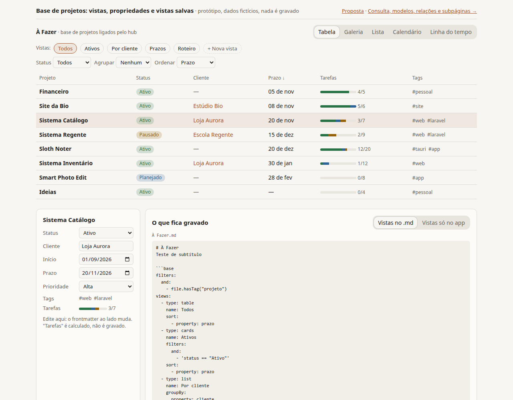
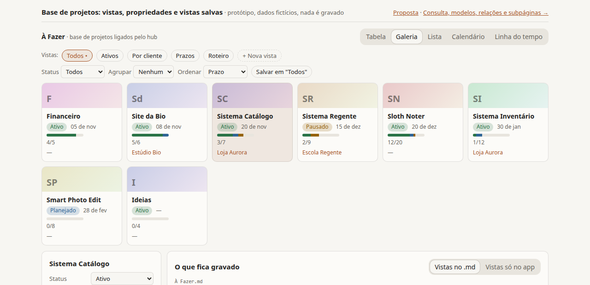
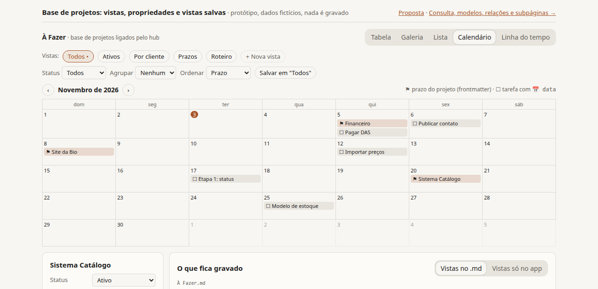
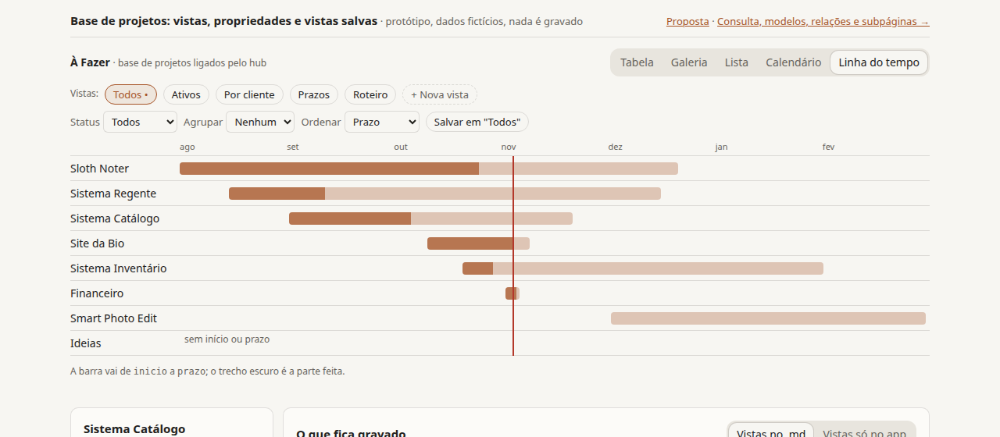
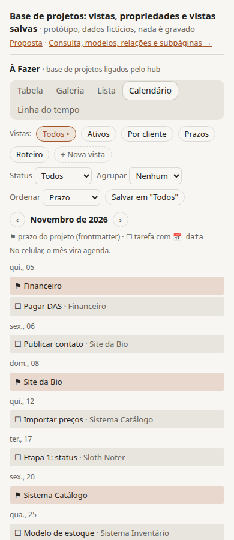
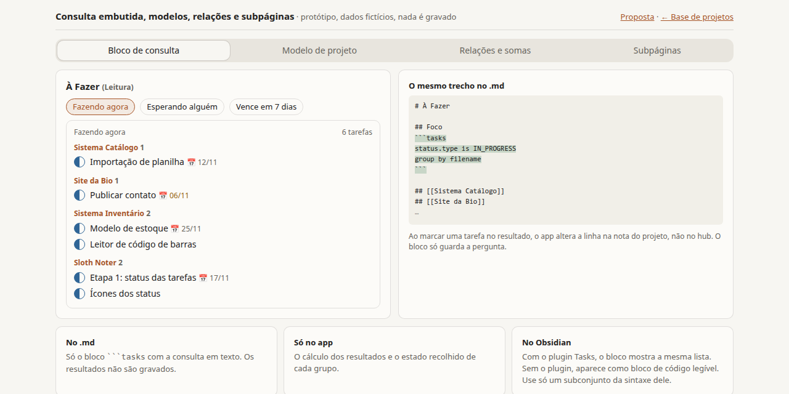
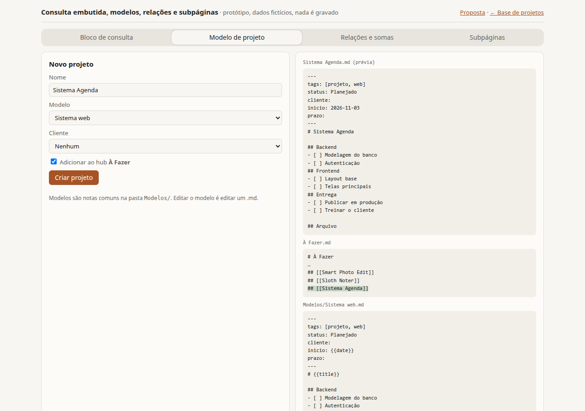
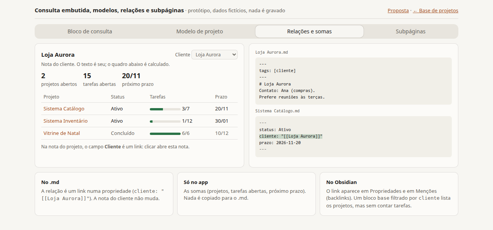
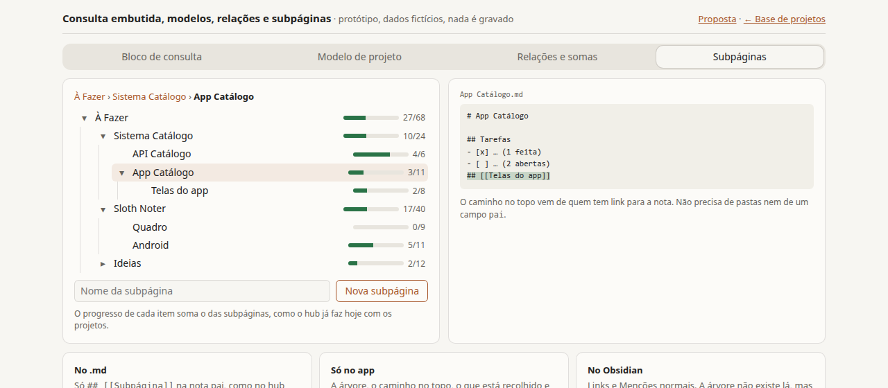
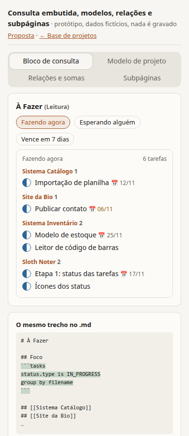

# Hub de projetos: propostas

> **Estado:** proposta, sem prioridade. Nada aqui foi aprovado nem entrou no
> [roteiro](ROADMAP.md). Registrado em 2026-11-03 para uma possível implementação futura.
>
> Protótipos navegáveis (dados fictícios, nada é gravado; abra no navegador):
> [`hub-prototype/base-de-projetos.html`](hub-prototype/base-de-projetos.html) e
> [`hub-prototype/blocos.html`](hub-prototype/blocos.html). As capturas estão na mesma pasta.

## Contexto

Hoje uma nota comum serve de hub de todos os projetos:

```md
# À Fazer

## [[Sistema Catálogo]]

## [[Site da Bio]]

## [[Sloth Noter]]
```

Cada H2 com `[[link]]` mostra um anel de progresso com as tarefas da nota ligada
(`sectionProgress` e `resolvedTasks`, em `src/tasks.js`). Cada nota de projeto tem seções
(Backend, Frontend…) com tarefas `- [ ]`.

As propostas abaixo partem do que o [plano de status, arquivo e quadro](plans/status-arquivo-quadro-tarefas.md)
já decidiu (ADRs [0004](adr/0004-status-de-tarefas-no-checkbox.md),
[0005](adr/0005-arquivo-de-tarefas-na-nota.md) e [0006](adr/0006-modo-quadro.md)): status no
caractere do checkbox, seção `## Arquivo` e modo Quadro. Várias delas dependem desse plano.

### Restrições que as propostas respeitam

- Os `.md` são a fonte de verdade e continuam compatíveis com o Obsidian, que usa a mesma pasta.
  Metadados que só o app entende ficam em `noteMeta`, fora do `.md`.
- O app funciona offline e não tem conta. Não há banco de dados obrigatório: tudo é calculado a
  partir dos `.md`.
- Contrato do produto: "um bloco de notas com Markdown". Todas as propostas são opcionais; uma nota
  sem frontmatter e sem blocos novos continua igual.

## Propostas mostradas antes (sem protótipo salvo)

Estas três foram mostradas numa conversa anterior. O protótipo delas não foi salvo; ficam só
descritas aqui.

1. **Resumo rico em cada `## [[Projeto]]`:** barra por status, próxima tarefa, última mudança e
   aviso de projeto parado.
2. **Expandir o projeto dentro do hub:** as tarefas ativas da nota ligada aparecem e podem ser
   editadas no próprio hub.
3. **Quadro de todos os projetos:** colunas são os status, raias são os projetos ligados.

## Propostas com protótipo

Cada proposta diz o que fica gravado no `.md`, o que fica só no app e como aparece no Obsidian.

### 4. Propriedades de projeto no frontmatter

Status do projeto, cliente, início, prazo, prioridade e tags, editáveis num painel no topo da nota,
como as propriedades de página do Notion.

```md
---
tags: [projeto, web, laravel]
status: Ativo
cliente: '[[Loja Aurora]]'
inicio: 2026-09-01
prazo: 2026-11-20
prioridade: Alta
---

# Sistema Catálogo
```

- **No `.md`:** o frontmatter YAML.
- **Só no app:** o painel de edição e os valores calculados (progresso, "parado há N dias").
- **No Obsidian:** aparece no painel Propriedades, com os mesmos tipos (texto, data, lista, link).
- **Atenção:** o app ainda não lê frontmatter. É preciso preservar chaves desconhecidas, comentários
  e a formatação, para não reescrever o arquivo sem aviso. Ler YAML pode exigir uma dependência;
  ela precisa caber no orçamento de leveza do roteiro.

### 5. Vistas de banco de dados sobre os projetos

Tabela, galeria, lista, calendário e linha do tempo sobre os projetos ligados pelo hub (ou sobre
as notas com a tag `projeto`).









- **No `.md`:** nada além das propriedades da proposta 4. O calendário de tarefas também precisa
  de prazos nas tarefas (`📅 AAAA-MM-DD`, ver "Decisões abertas").
- **Só no app:** as vistas, a vista aberta, a largura das colunas e o mês do calendário.
- **No Obsidian:** tabela, cartões e lista existem no plugin nativo Bases. Calendário e linha do
  tempo não existem lá.
- **Atenção:** o Bases lê só propriedades. Ele não conta tarefas, então a coluna de progresso
  existe só no Sloth Note. No celular, o calendário vira agenda (lista por dia).



### 6. Vistas salvas (filtro, agrupamento e ordem)

Botões "Todos", "Ativos", "Por cliente"… no topo do hub, cada um com tipo de vista, filtro,
agrupamento e ordem. "+ Nova vista" e "Salvar" guardam a combinação atual.

Há duas formas de gravar, e o protótipo mostra as duas lado a lado:

- **No `.md` (bloco `base`):** tabela, cartões e lista ficam num bloco ` ```base ` no hub, que o
  Obsidian abre como vista do Bases. Calendário e linha do tempo continuam em `noteMeta`, porque o
  Bases não tem esses tipos. Ordenar por progresso também fica só no app.
- **Só no app (`noteMeta`):** o `.md` não muda. As vistas não aparecem no Obsidian.

O bloco `base` do protótipo é uma aproximação. Antes de gravar nesse formato, confira as chaves
na página oficial da sintaxe do Bases.

### 7. Bloco de consulta embutido

Um bloco ` ```tasks ` no hub, por exemplo numa seção `## Foco`, lista tarefas de todos os
projetos: "Fazendo agora", "Esperando alguém", "Vence em 7 dias". Marcar uma tarefa no resultado
altera a linha na nota do projeto, não no hub, com "Desfazer".



````md
## Foco

```tasks
status.type is IN_PROGRESS
group by filename
```
````

- **No `.md`:** só o texto da consulta. Os resultados não são gravados.
- **Só no app:** o cálculo dos resultados e os grupos recolhidos.
- **No Obsidian:** com o plugin Tasks, o bloco mostra a mesma lista. Sem o plugin, aparece como
  bloco de código legível.
- **Atenção:** aceitar só um subconjunto pequeno da sintaxe do Tasks. No Tasks, `[>]` só vira
  "Esperando" com um status personalizado nas configurações do plugin. A sintaxe do protótipo foi
  conferida por partes na documentação, não testada no Obsidian.

### 8. Modelos de projeto

"Novo projeto" cria a nota a partir de um modelo (Sistema web, Site, Pessoal), preenche o
frontmatter e, se a pessoa quiser, acrescenta `## [[Novo projeto]]` no hub.



- **No `.md`:** o modelo é uma nota comum com `{{title}}` e `{{date}}`. O projeto criado é um `.md`
  comum.
- **Só no app:** onde ficam os modelos e o último modelo usado.
- **No Obsidian:** o plugin nativo Modelos (Templates) usa os mesmos `{{title}}` e `{{date}}`, então
  a mesma pasta serve nos dois.
- **Atenção:** o protótipo usa uma pasta `Modelos/`, mas o roteiro ainda não decidiu se subpastas
  entram. Sem subpastas, os modelos precisam de outra marca, como a tag `modelo`.

### 9. Relações e somas entre notas

O campo `cliente: "[[Loja Aurora]]"` liga o projeto ao cliente. A nota do cliente mostra um quadro
calculado: projetos abertos, tarefas abertas, próximo prazo e a lista de projetos.



- **No `.md`:** só o link na propriedade do projeto. A nota do cliente não muda.
- **Só no app:** as somas. Nada é copiado para o `.md`.
- **No Obsidian:** o link aparece em Propriedades e em Menções (backlinks). Um bloco `base`
  filtrado por `cliente` lista os projetos, mas sem contar tarefas.
- **Atenção:** depende da proposta 4 e de um índice de links de entrada.

### 10. Subpáginas

Um projeto pode ter subpáginas (`## [[API Catálogo]]` dentro de `Sistema Catálogo`), como o hub já
faz com os projetos. O app mostra uma árvore com o progresso somado e um caminho no topo
("À Fazer › Sistema Catálogo › App Catálogo").



- **No `.md`:** só `## [[Subpágina]]` na nota pai. Cada subpágina é um `.md` na mesma pasta.
- **Só no app:** a árvore, o caminho, os itens recolhidos e as somas.
- **No Obsidian:** links e Menções normais. A árvore não existe lá.
- **Atenção:** o caminho vem de quem tem link para a nota, sem pastas nem campo `pai`. Uma nota
  ligada em dois lugares mostra o primeiro caminho e avisa "também ligada em…". Ciclos de links
  precisam ser ignorados na soma, como `resolvedTasks` já faz.

## Decisões abertas

Cada item abaixo pede um ADR antes de implementar:

- **Formato das propriedades:** nomes das chaves (pt-BR ou inglês), tipos, como preservar YAML
  escrito à mão e se o app cria o frontmatter sozinho ou só quando a pessoa pede.
- **Onde gravar as vistas salvas:** bloco `base` no `.md` ou `noteMeta`.
- **Prazo nas tarefas:** adotar `📅 AAAA-MM-DD` do plugin Tasks, como o `✅`/`❌` do ADR 0004.
- **Subconjunto da consulta:** quais comandos do Tasks o app aceita e o que faz com os outros.
- **Subpastas:** necessária para `Modelos/`; já está em aberto no roteiro.

## Recomendação

Combinação: **propriedades (4) + tabela e lista com vistas salvas (5, 6) + bloco Foco (7) +
subpáginas (10)**. Galeria, linha do tempo e somas por cliente (9) ficam para depois.

Ordem sugerida:

1. Terminar o plano de status, arquivo e quadro. As barras por status e o bloco Foco dependem dele.
2. Subpáginas (10). É barato e não muda o formato dos arquivos.
3. Propriedades (4), com ADR do formato.
4. Tabela e lista no hub (5, 6), com as vistas só em `noteMeta` no começo. O bloco `base` no `.md`
   entra depois, como opção, quando a sintaxe do Bases estiver validada.
5. Bloco Foco (7), com um subconjunto pequeno da sintaxe do Tasks.
6. Modelos (8), depois da decisão sobre subpastas.
7. Calendário e linha do tempo, depois da decisão sobre `📅`. Por último, galeria e somas (9).

## Sobre os protótipos

- HTML sem dependências externas, com as cores de `src/styles.css`. Usa o tema do sistema
  (claro ou escuro).
- Conferidos em 728 e 390 px (tema escuro) e capturados em 1280 e 390 px (tema claro).
- Dados fictícios. Os protótipos ilustram a proposta; não comprovam desempenho nem a
  compatibilidade real com o Obsidian.



## Fontes

- [Sintaxe do Bases (ajuda do Obsidian)](https://help.obsidian.md/bases/syntax)
- [Plugin Tasks para Obsidian](https://github.com/obsidian-tasks-group/obsidian-tasks)
- [Status personalizados no Tasks (Obsidian Rocks)](https://obsidian.rocks/?p=2380)
