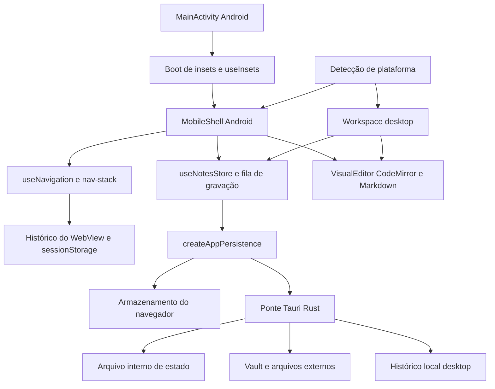

# Arquitetura

O Sloth Note edita Markdown localmente. As interfaces desktop e mobile compartilham o formato das
notas e a persistência; a plataforma determina a interface, sem depender da largura da janela.

## Componentes

- `src/main.jsx`: inicialização e interface desktop, além da seleção da casca.
- `src/mobile/`: casca, adaptação dos insets, navegação serializável e ações mobile de notas.
- `src/hooks/use-notes-store.js`: documento em memória, gravações serializadas e histórico.
- `src/visual-editor.jsx` e `src/markdown.jsx`: edição e leitura compartilhadas.
- `src/persistence-runtime.js`: escolhe navegador, arquivo interno Tauri ou vault configurado.
- `src-tauri/`: operações nativas de arquivos, imagens, histórico e integração com a plataforma.

O histórico de navegação contém rotas, busca, rolagem e cursor; o texto das notas permanece na
persistência do documento. Camadas transitórias não reabrem ao iniciar uma nova sessão. A rota
usa `sessionStorage`; a recuperação após morte do processo Android ainda precisa de contrato e
validação nativos. Compartilhar modelo e persistência não sincroniza dispositivos.

O Kotlin publica insets; `public/insets-boot.js` recebe os valores e o CSS mobile aplica o espaço de
barras/IME, sem padding nativo no WebView. A combinação de `adjustResize`, `100dvh`, viewport visual
e padding CSS ainda exige medição no APK. O boot instala o receptor antes do bundle, mas não garante
que os valores nativos já tenham chegado no primeiro frame.

As ações de `use-note-actions.js` permanecem ligadas ao desktop. Mobile reutiliza funções de domínio
por `mobile/note-actions.js`; não existe ainda um registro único de ações entre as cascas. Código no
desktop usa `textarea`; o editor desse modo mobile será escolhido no incremento correspondente.
As telas mobile ainda não oferecem todos os recursos desktop; veja o plano em andamento.

O histórico de versões permanece local, conforme ADR 0002. Sua interface foi entregue no desktop;
a integração mobile completa ainda está pendente. Não confundir com histórico de navegação nem
com o futuro histórico de conclusão de tarefas.

## Decisões

Veja `docs/adr/`. O andamento da interface Android está em
[docs/plans/mobile-interface.md](plans/mobile-interface.md).
