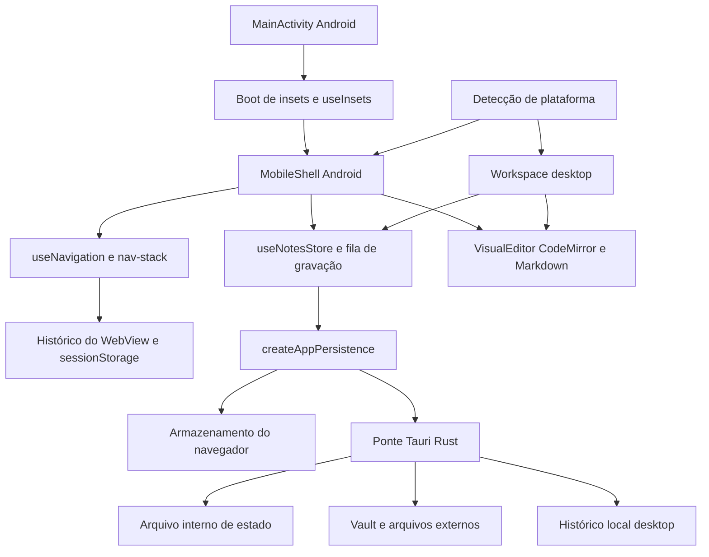

# Arquitetura

O Sloth Note edita Markdown localmente. As interfaces desktop e mobile compartilham o formato das
notas e a persistência; a plataforma determina a interface, sem depender da largura da janela.

## Componentes

- `src/main.jsx`: inicialização e interface desktop, além da seleção da casca.
- `src/mobile/`: casca, adaptação dos insets, navegação serializável e ações mobile de notas.
- `src/hooks/use-notes-store.js`: documento em memória, gravações serializadas e histórico.
- `src/visual-editor.jsx` e `src/markdown.jsx`: edição e leitura compartilhadas.
- `src/persistence-runtime.js`: escolhe navegador, arquivo interno Tauri ou vault configurado.
- `src-tauri/`: operações nativas de arquivos, imagens, histórico e integração com a plataforma.

O histórico de navegação contém rotas, busca, rolagem e cursor; o texto das notas permanece na
persistência do documento. Camadas transitórias não reabrem ao iniciar uma nova sessão.
As telas mobile ainda não oferecem todos os recursos desktop; veja o plano em andamento.

## Decisões

Veja `docs/adr/`. O andamento da interface Android está em
[docs/plans/mobile-interface.md](plans/mobile-interface.md).
